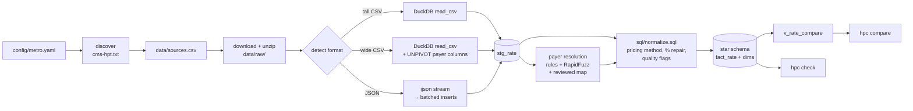
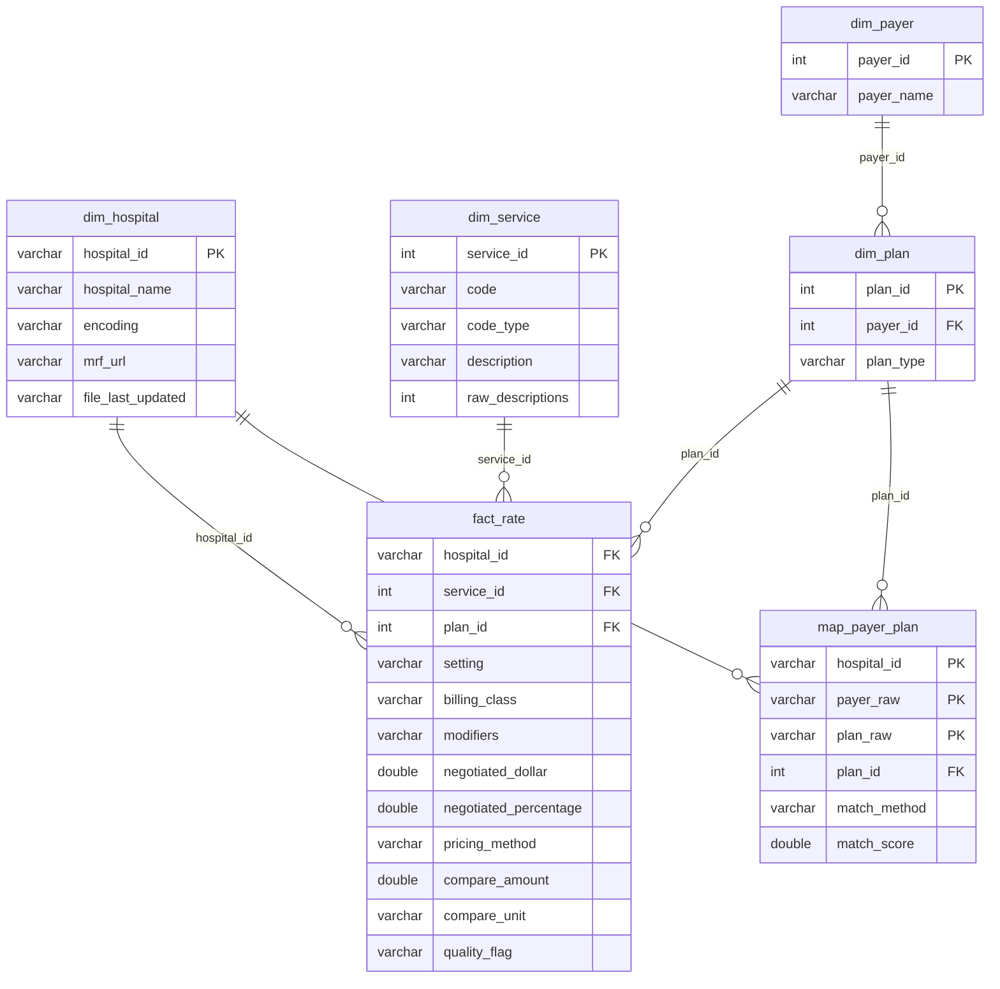

# hospital-price-compare

A small data pipeline that takes the negotiated-rate files US hospitals are required to publish and makes them comparable: for one billing code, which hospital charges which payer what, and how that rate is calculated. It is aimed at the people who currently do this by hand: employer benefits teams, health-plan and healthcare analysts, patient advocates and local journalists.

The first metro is **Boise, Idaho** (Boise City MSA): five hospitals from three health systems, published in all three CMS encodings.

| Hospital | City | System | File encoding |
|---|---|---|---|
| St. Luke's Boise Medical Center | Boise | St. Luke's | wide CSV (481 MB) |
| Saint Alphonsus Regional Medical Center | Boise | Trinity Health | tall CSV in a zip (6.3 GB unzipped) |
| St. Luke's Nampa Medical Center | Nampa | St. Luke's | wide CSV (347 MB) |
| Saint Alphonsus Medical Center Nampa | Nampa | Trinity Health | tall CSV in a zip (4.0 GB unzipped) |
| West Valley Medical Center | Caldwell | HCA | JSON (243 MB) |

## Why

Since 2021 hospitals have had to post every negotiated rate in a machine-readable file, but the files don't line up with each other. KFF's [ongoing challenges with hospital price transparency](https://www.healthsystemtracker.org/brief/ongoing-challenges-with-hospital-price-transparency/) brief walks through why, and these five files show all of it:

- **Payer names are each hospital's own.** St. Luke's writes `BLUE CROSS IDAHO [1007]` with the plan `HB NAMPA SLHP BLUE CROSS CAREPOINT QHP`; West Valley writes `Blue Cross` / `PPO`; Saint Alphonsus lists every out-of-state Blue plan separately (`BLUE CROSS - AK (PREMERA)`). Across the five files there are 839 distinct payer names.
- **There is no plan-type field.** Whether a rate is commercial, Medicare Advantage or Medicaid has to be read from free text, and abbreviations like `MA` are ambiguous.
- **Pricing methods are mixed.** St. Luke's prices a colonoscopy as 80% of billed charges, Saint Alphonsus as a $9,000 case rate or a fee-schedule dollar amount, West Valley as a $6,199 case rate. Putting those in one column and sorting gives nonsense.
- **Three encodings.** The [CMS templates](https://github.com/CMSgov/hospital-price-transparency) allow a tall CSV, a wide CSV (one column group per payer and plan) and JSON.

## How it works



1. **Discover** (`hpc/discover.py`) – every hospital must publish `https://<domain>/cms-hpt.txt` listing its file URL. The configured `location-name` is looked up there and the URL and fetch time are written to `data/sources.csv`.
2. **Ingest** (`hpc/ingest/`) – the format is detected from the first megabyte (zip magic, `{`, or the CSV header on row 3). Tall CSVs are read straight into DuckDB. Wide CSVs are filtered to the wanted codes, then the payer columns (`standard_charge|<payer>|<plan>|negotiated_dollar`, …) are `UNPIVOT`ed, split on `|` and pivoted back into one row per payer and plan. JSON is streamed item by item with ijson because `json.load` on a 243 MB document would hold all of it in memory. DuckDB runs with `memory_limit = 1GB` and two threads (set in `config/metro.yaml`) and spills to disk past that.
3. **Resolve payers** (`hpc/resolve.py`) – a reviewed mapping table (`config/payer_map.csv`) wins; otherwise alias rules from `config/payers.yaml` (longest alias first, carrier names before program words like `MEDICARE`, then the plan column when the payer column just says `COMMERCIAL`), then RapidFuzz `token_sort_ratio ≥ 88` for typos. Anything left keeps its cleaned name and is marked `unresolved`. Plan type comes from the text; `MA` is read as Medicaid for Medicaid-only payers (Molina, Magellan) and as Medicare Advantage otherwise.
4. **Normalise** (`sql/normalize.sql`) – each rate gets a pricing method (`flat_dollar`, `percent_of_charges`, `per_diem`, `case_rate`, or `other`, which is never compared) and a compare amount. Percent-of-charges rates are compared as a percentage, never as dollars. Every rate also gets a `quality_flag`.

### Schema

`sql/schema.sql` defines a star schema with `fact_rate` in the middle:



- `dim_hospital`: one row per loaded file, with its encoding, source URL and file date
- `dim_service`: one row per CPT / HCPCS / DRG code, plus how many different descriptions the files use for it
- `dim_payer`, `dim_plan`: resolved payer, and payer × plan type
- `map_payer_plan`: each hospital's raw payer/plan strings → `dim_plan`, with match method and score
- `fact_rate`: one negotiated rate: setting, billing class, modifiers, gross charge, dollar, percentage, `pricing_method`, `compare_amount`, `compare_unit`, `quality_flag`
- `v_rate_compare`: rates with the median of their comparison group. A group is code × setting × billing class × modifiers × pricing method, so a professional fee, a discontinued-procedure (`-74`) rate and a percent-of-charges rate never sit in the same ranking
- `v_compare_summary`: one row per comparison group with its rate count and min / median / max

### Quality flags

| flag | meaning |
|---|---|
| `ok` | nothing found |
| `pct_in_dollar_field` | percent-of-charges rate whose only number is a dollar value ≤ 1 with no usable gross charge, so `$0.76` is read as 76% |
| `pct_rescaled` | percentage written as a fraction (`0.76`) and scaled to 76 |
| `pct_derived` | percentage missing; taken from the notes ("79.1% of billable gross charges") or dollar ÷ gross charge |
| `method_unknown` | methodology `other` with nothing to classify it; not compared |
| `no_amount`, `zero_amount` | nothing to compare |
| `above_gross` | flat or case rate above the hospital's own gross charge |
| `pct_over_100` | percent of charges above 100 |
| `payer_unresolved` | payer name not matched to a known payer |
| `method_inferred` | methodology missing or `other`, method read from the other fields |
| `billing_class_assumed` | file has no billing class; treated as facility |

The `$0.76` case is a real one. Saint Alphonsus Nampa lists clobazam 10 mg at a $2.85 gross charge, 26.78% of billed charges, with `.76` in the dollar column. A naive rule would call that 76% or 76 cents, but the pipeline compares it as 26.78% of charges. The test fixtures keep that row.

## Interface

```
python3 -m hpc discover [--hospitals N]          # cms-hpt.txt -> data/sources.csv
python3 -m hpc ingest  --metro config/metro.yaml [--hospitals N] [--all-codes]
python3 -m hpc check   [--min-hospitals N] [--min-encodings N]
python3 -m hpc compare --code 45378 [--setting outpatient] [--limit 25|0] [--format table|csv]
python3 -m hpc payers  [--unresolved] [--out review.csv]
```

By default `ingest` keeps the 72 codes in `config/shoppable_codes.csv` (the CPT codes from CMS's list of 70 shoppable services). `--all-codes` keeps every row.

Real output, trimmed to four rows per group:

```
$ python3 -m hpc compare --code 45378 --setting outpatient --limit 4
45378  PR Colonoscopy Flexible Diagnostic W Collection Specimen Brushing/Washing
Rates are only compared within one setting, billing class, modifier set and pricing method.

== outpatient | facility | case rate | 3 hospitals, median $6,199.00
   hospital                                 payer                                plan type                            rate vs median  plans  flag
   West Valley Medical Center               UnitedHealthcare                     commercial                      $6,199.00       +0%      1  billing_class_assumed
   Saint Alphonsus Medical Center Nampa     Cigna                                commercial                      $9,000.00      +45%      2  ok
   Saint Alphonsus Medical Center Nampa     Providence Health Plan               commercial                      $9,000.00      +45%      1  ok
   Saint Alphonsus Regional Medical Center  Cigna                                commercial                     $12,650.00     +104%      2  ok
   ... 1 more (use --limit 0)

== outpatient | facility | flat dollar amount | 5 hospitals, median $1,054.35
   hospital                                 payer                                plan type                            rate vs median  plans  flag
   West Valley Medical Center               Blue Cross of Idaho                  medicaid                          $302.60      -71%      2  billing_class_assumed
   West Valley Medical Center               Magellan Healthcare                  medicaid                          $302.60      -71%      1  billing_class_assumed
   West Valley Medical Center               Molina Healthcare                    medicaid                          $302.60      -71%      1  billing_class_assumed
   Saint Alphonsus Medical Center Nampa     Molina Healthcare                    medicaid                          $344.25      -67%      1  ok
   ... 71 more (use --limit 0)

== outpatient | facility | percent of billed charges | 2 hospitals, median 77.5% of charges
   hospital                                 payer                                plan type                            rate vs median  plans  flag
   St. Luke's Boise Medical Center          PacificSource                        commercial               75.0% of charges       -3%      1  pct_derived
   St. Luke's Nampa Medical Center          PacificSource                        commercial               75.0% of charges       -3%      1  pct_derived
   St. Luke's Boise Medical Center          MultiPlan                            commercial               80.0% of charges       +3%      1  pct_derived
   St. Luke's Nampa Medical Center          MultiPlan                            commercial               80.0% of charges       +3%      1  pct_derived
...
```

`plans` is how many raw payer/plan strings collapsed into that row.

## Running it locally

Python 3.10+ (I used 3.11). No services and no Docker: DuckDB is an embedded file at `data/hpc.duckdb`.

The dependencies (duckdb, pandas, rapidfuzz, ijson, PyYAML, requests, and pytest for the tests) are listed in `pyproject.toml` and `requirements.txt`. Then:

```
python3 -m hpc ingest --metro config/metro.yaml --hospitals 5
python3 -m hpc check --min-hospitals 5
python3 -m hpc compare --code 45378
```

The first `ingest` downloads about 1.6 GB into `data/raw/` (gitignored), and unzipping the two Saint Alphonsus files takes about 10 GB of disk. Later runs reuse the cached files unless the URL in `cms-hpt.txt` changes. With files cached, the default run (72 shoppable codes) takes about 30 seconds, stores 180,454 rates and peaks at 426 MB of memory (the command prints this).

## Testing

```
python3 -m pytest -q
```

60 tests run in about a second against `tests/fixtures/`: trimmed excerpts of the real St. Luke's Nampa wide CSV, Saint Alphonsus Nampa tall CSV, West Valley JSON and the Saint Alphonsus `cms-hpt.txt` (cut by `scripts/trim_fixtures.py`). They cover format detection including zips, the wide-file unpivot (row counts and values checked against an independent `csv` parse), streaming JSON, payer resolution including the `MA` ambiguity, every pricing-method rule, the `$0.76` case and its variants, and ingest → check → compare end to end. Two of them corrupt a copy of the database (a percent rate relabelled as dollars, and a ranking view that ignores the pricing method) and confirm `hpc check` fails. The fixtures' attester names and contact details are replaced with placeholders.

`hpc check` is the data-level test for a real load. It asserts that every staged row became a rate, that enough hospitals and encodings are covered, that each ranked group holds one pricing method and one unit and that its median is computed over exactly that group's rates, that every rate has a quality flag, and that every fact joins to its dimensions.

## Results

From the default load (72 shoppable codes, five hospitals):

- 180,454 negotiated rates, of which 180,229 have a comparable amount
- 839 raw payer names appear in 1,944 hospital-specific payer/plan strings. 1,804 of those strings (92.8%) resolve to 38 known payers and 76 payer × plan-type plans. The other 140 stay `unresolved`, mostly Medicare Advantage plans from carriers outside Idaho, and keep their cleaned names as their own payers
- 817 comparison groups, none mixing pricing methods

`hpc check` prints the comparable-rate and payer-resolution numbers above.

The flags on those rates: 150,130 `ok`, 12,539 `payer_unresolved`, 11,597 `billing_class_assumed` (the West Valley JSON and St. Luke's files), 2,588 `above_gross`, 1,999 `method_inferred` and 1,376 `pct_derived`. The remaining 225 are `no_amount` or `method_unknown`.

## Known issues

- `--all-codes` over all five files (about 22 million rates) gets killed for memory on my 6 GB machine, even with DuckDB capped at 768 MB and one thread. I haven't yet found which step goes past the cap. The default shoppable-code load is the one that is tested and checked.
- Out-of-state Blue Cross plans (BlueCard) are folded into Blue Cross of Idaho, since local claims are priced under the local Blue contract. That is a judgement call, not something the files state.
- St. Luke's files use the setting `both`, which is kept apart from `inpatient` / `outpatient`, so some St. Luke's rates sit in their own group.
- The payer alias list is hand-written for Boise. A new metro needs its own aliases and a review pass with `hpc payers --unresolved --out review.csv`.
- The St. Luke's percent-of-charges rates carry `pct_derived` because the percentage column is filled only for some payers. The derived values match the posted ones wherever both exist, but they are still estimates.
- Downloading depends on the hospitals' URLs. West Valley's is a signed Azure blob URL that changes, so `ingest` re-reads `cms-hpt.txt` on every run.

## Roadmap

- Payer resolution and pricing-method classification at metro scale: more hospitals, a reviewed mapping for every raw payer string, and a measured match rate against that review.
- A Power BI report (PBIP with a TMDL semantic model over the DuckDB star schema) and a static demo page.
- Loading the CMS shoppable-services list and MS-DRGs directly instead of the hand-copied code list.

Project period: 2026-07-18 to 2026-07-20.
