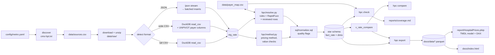
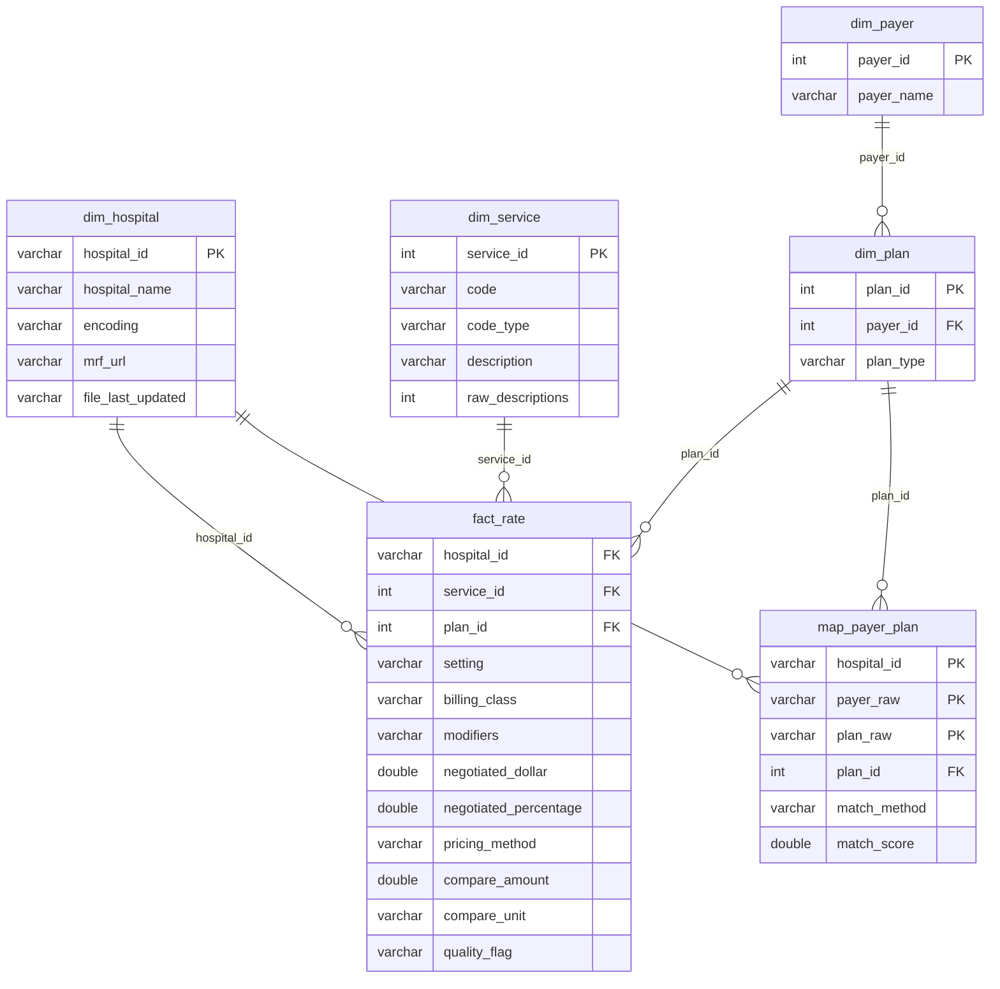
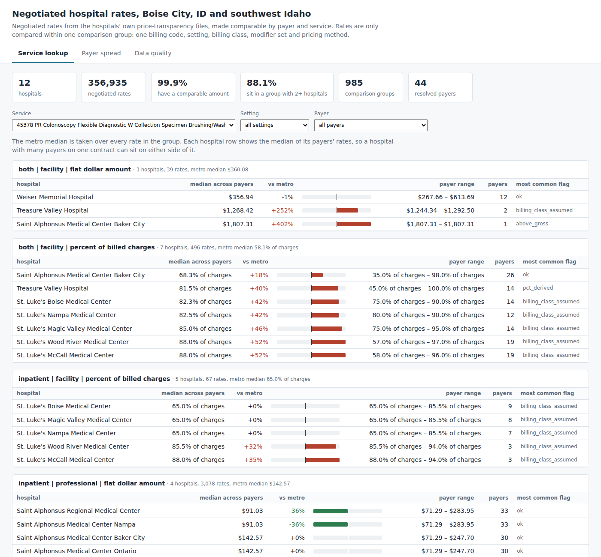

# hospital-price-compare

A small data pipeline that takes the negotiated-rate files US hospitals are required to publish and makes them comparable: for one billing code, which hospital charges which payer what, and how that rate is calculated. It is aimed at the people who currently do this by hand: employer benefits teams, health-plan and healthcare analysts, patient advocates and local journalists.

The results come out three ways: the `hpc compare` command, a Power BI project (`report/HospitalPrices.pbip`) with a TMDL semantic model and DAX measures, and a static page at `docs/index.html` built from the same Parquet tables for anyone without Power BI.

The first metro is **Boise, Idaho**. The five general hospitals of the Boise City MSA come first, published in all three CMS encodings. To get to twelve I added the rest of what I could find around them: Treasure Valley Hospital (the only other Boise MSA hospital whose `cms-hpt.txt` points at a downloadable file), Ontario and Weiser from the wider Boise–Mountain Home–Ontario area, and the two Boise systems' other hospitals in southern Idaho and eastern Oregon, which contract with the same payers. St. Luke's Meridian and Elmore share the St. Luke's Boise file, so they are not separate rows.

| Hospital | City | System | File encoding |
|---|---|---|---|
| St. Luke's Boise Medical Center | Boise | St. Luke's | wide CSV (481 MB) |
| Saint Alphonsus Regional Medical Center | Boise | Trinity Health | tall CSV in a zip (6.3 GB unzipped) |
| St. Luke's Nampa Medical Center | Nampa | St. Luke's | wide CSV (347 MB) |
| Saint Alphonsus Medical Center Nampa | Nampa | Trinity Health | tall CSV in a zip (4.0 GB unzipped) |
| West Valley Medical Center | Caldwell | HCA | JSON (243 MB) |
| Treasure Valley Hospital | Boise | physician-owned surgical | wide CSV, Latin-1 (54 MB) |
| Saint Alphonsus Medical Center Ontario | Ontario, OR | Trinity Health | tall CSV in a zip |
| Weiser Memorial Hospital | Weiser | independent | tall CSV (79 MB) |
| St. Luke's Magic Valley Medical Center | Twin Falls | St. Luke's | wide CSV |
| St. Luke's Wood River Medical Center | Ketchum | St. Luke's | wide CSV |
| St. Luke's McCall Medical Center | McCall | St. Luke's | wide CSV |
| Saint Alphonsus Medical Center Baker City | Baker City, OR | Trinity Health | tall CSV in a zip |

## Why

Since 2021 hospitals have had to post every negotiated rate in a machine-readable file, but the files don't line up with each other. KFF's [ongoing challenges with hospital price transparency](https://www.healthsystemtracker.org/brief/ongoing-challenges-with-hospital-price-transparency/) brief walks through why, and these files show all of it:

- **Payer names are each hospital's own.** St. Luke's writes `BLUE CROSS IDAHO [1007]` with the plan `HB NAMPA SLHP BLUE CROSS CAREPOINT QHP`; West Valley writes `Blue Cross` / `PPO`; Treasure Valley writes `BCI` / `Commercial`; Saint Alphonsus lists every out-of-state Blue plan separately (`BLUE CROSS - AK (PREMERA)`). Across the twelve files there are 872 distinct payer names.
- **There is no plan-type field.** Whether a rate is commercial, Medicare Advantage or Medicaid has to be read from free text, and abbreviations like `MA` are ambiguous. In these files `BLUE CROSS - MA` is Blue Cross of *Massachusetts* and `MEDICAID - MA` is MassHealth; a rule that reads `MA` as Medicare Advantage gets both wrong.
- **Pricing methods are mixed.** St. Luke's prices a colonoscopy as 80% of billed charges, Saint Alphonsus as a $9,000 case rate or a fee-schedule dollar amount, West Valley as a $6,199 case rate. Putting those in one column and sorting gives nonsense.
- **Three encodings.** The [CMS templates](https://github.com/CMSgov/hospital-price-transparency) allow a tall CSV, a wide CSV (one column group per payer and plan) and JSON.

## How it works



1. **Discover** (`hpc/discover.py`) – every hospital must publish `https://<domain>/cms-hpt.txt` listing its file URL. The configured `location-name` is looked up there and the URL and fetch time are written to `data/sources.csv`.
2. **Ingest** (`hpc/ingest/`) – the format is detected from the first megabyte (zip magic, `{`, or the CSV header on row 3). Header names are matched with spaces around `|` ignored (Weiser writes `standard_charge | gross`), and a CSV that fails as UTF-8 is re-read as Latin-1 (Treasure Valley). Tall CSVs are read straight into DuckDB. Wide CSVs are filtered to the wanted codes, then the payer columns (`standard_charge|<payer>|<plan>|negotiated_dollar`, …) are `UNPIVOT`ed, split on `|` and pivoted back into one row per payer and plan. JSON is streamed item by item with ijson because `json.load` on a 243 MB document would hold all of it in memory. DuckDB runs with `memory_limit = 1GB` and two threads (set in `config/metro.yaml`) and spills to disk past that.
3. **Resolve payers** (`hpc/resolve.py`) – rows in `data/payer_map.csv` that a person has checked (`reviewed=yes`) win; otherwise alias rules from `config/payers.yaml` (longest alias first, carrier names before program words like `MEDICARE`, then the plan column when the payer column just says `COMMERCIAL`), then RapidFuzz `token_sort_ratio ≥ 88` for typos. Anything left keeps its cleaned name and is marked `unresolved`. Plan type comes from the text. A bare `MA` is read as Medicaid for Medicaid-only payers (Molina, Magellan) and otherwise left as plan type `unknown` with status `ambiguous` instead of being guessed; `BLUE CROSS - XX` state codes are removed before plan type is read. Every ingest merges each raw payer/plan pair into `data/payer_map.csv` (status `resolved`, `ambiguous` or `unresolved`, `reviewed=no` for new rows) without touching checked rows, so the file is the review queue.
4. **Classify pricing method** (`hpc/method.py`) – the CMS `methodology` field when it holds one of the four template values, otherwise the algorithm text (`per diem`, `per day`, `case rate`, `per admission`, `% of billed charges`), otherwise which number is filled in. Then value checks: a percentage sitting in the dollar column, a fraction written for a percentage, a missing percentage recovered from the notes or dollar ÷ gross, a percentage of *Medicare or another fee schedule* (`120% of current Medicare`, `APC rate x 135%`), and a dollar methodology with only a percentage filled in. The last two become `other` and are never compared.
5. **Normalise** (`sql/normalize.sql`) – each rate gets its method (`flat_dollar`, `percent_of_charges`, `per_diem`, `case_rate`, or `other`) and a compare amount. Percent-of-charges rates are compared as a percentage, never as dollars. Every rate also gets a `quality_flag`.
6. **Export** (`hpc/export.py`) – the star schema is flattened into seven Parquet tables in `docs/data/` (one fact table `rate`, plus `hospital`, `service`, `plan`, `comparison_group`, `quality_flag`, and `payer_string` for the payer review). Each rate carries its comparison group, the group's metro median from `v_rate_compare` and its distance from that median. `docs/index.html` is then built by reading those Parquet files back, so the page and the Power BI model can't drift apart.

### Schema

`sql/schema.sql` defines a star schema with `fact_rate` in the middle:



- `dim_hospital`: one row per loaded file, with its encoding, source URL and file date
- `dim_service`: one row per CPT / HCPCS / DRG code, plus how many different descriptions the files use for it
- `dim_payer`, `dim_plan`: resolved payer, and payer × plan type
- `map_payer_plan`: each hospital's raw payer/plan strings → `dim_plan`, with match method and score
- `fact_rate`: one negotiated rate: setting, billing class, modifiers, gross charge, dollar, percentage, `pricing_method`, `compare_amount`, `compare_unit`, `quality_flag`
- `v_rate_compare`: rates with the median of their comparison group. A group is code × setting × billing class × modifiers × pricing method, so a professional fee, a discontinued-procedure (`-74`) rate and a percent-of-charges rate never sit in the same ranking
- `v_compare_summary`: one row per comparison group with its rate count and min / median / max

### Quality flags

| flag | meaning |
|---|---|
| `ok` | nothing found |
| `pct_in_dollar_field` | percent-of-charges rate whose only number is a dollar value ≤ 1 with no usable gross charge, so `$0.76` is read as 76% |
| `pct_rescaled` | percentage written as a fraction (`0.76`) and scaled to 76 |
| `pct_derived` | percentage missing; taken from the notes ("79.1% of billable gross charges") or dollar ÷ gross charge |
| `method_value_mismatch` | methodology says fee schedule, case rate or per diem but only a percentage is given; not compared |
| `pct_of_fee_schedule` | a percentage of Medicare or another fee schedule, not of charges; not compared |
| `method_unknown` | methodology `other` with nothing to classify it; not compared |
| `no_amount`, `zero_amount` | nothing to compare |
| `above_gross` | flat or case rate above the hospital's own gross charge |
| `pct_over_100` | percent of charges above 100 |
| `payer_unresolved` | payer name not matched to a known payer |
| `plan_type_ambiguous` | plan type left `unknown` on purpose (a bare `MA`) |
| `method_inferred` | methodology missing or `other`, method read from the other fields |
| `billing_class_assumed` | file has no billing class; treated as facility |

The `$0.76` case is a real one. Saint Alphonsus Nampa lists clobazam 10 mg at a $2.85 gross charge, 26.78% of billed charges, with `.76` in the dollar column. A naive rule would call that 76% or 76 cents, but the pipeline compares it as 26.78% of charges. The test fixtures keep that row.

### Power BI report and docs page

`report/` is a Power BI project in the PBIP format, so the model and pages are plain text files that diff in git:

```
report/
├── HospitalPrices.pbip
├── HospitalPrices.SemanticModel/definition/
│   ├── model.tmdl, relationships.tmdl, expressions.tmdl
│   └── tables/  rate, hospital, service, plan, comparison_group, quality_flag, payer_string
└── HospitalPrices.Report/definition/pages/
    ├── service_lookup/   service, setting and method slicers; rates by group, hospital and payer
    ├── payer_spread/     each payer's typical distance from the metro median, and payer x hospital
    └── data_quality/     comparable share, payer strings resolved, flags and methods by hospital
```

Each table is imported with `Parquet.Document(File.Contents(ParquetFolder & "<table>.parquet"))`. `ParquetFolder` is a text parameter; after opening the `.pbip`, set it to your checkout's `docs\data\` folder (Transform data → Edit parameters) and refresh.

The DAX measures live on the `rate` and `payer_string` tables:

| measure | what it is |
|---|---|
| `Median Negotiated Rate` | median `compare_amount`, but blank unless the filter holds exactly one comparison group, so a visual can't take a median over case rates and percentages at once |
| `Metro Median Rate` | the same median with the hospital and payer filters removed |
| `Spread vs Metro Median` | `Median Negotiated Rate / Metro Median Rate - 1` |
| `Typical Spread vs Metro Median` | median of each dollar rate's own distance from its group's metro median; this one works across codes, so the payer page can rank payers |
| `Share of Comparable Rates` | rates with a comparable amount ÷ all rates |
| `Share of Flagged Rates`, `Share of Payer Strings Resolved` | for the data-quality page |

`docs/index.html` shows the same three views without Power BI. It is one self-contained file (no CDN, about 0.8 MB with the data inlined), so it works from disk or GitHub Pages:



## Interface

```
python3 -m hpc discover [--hospitals N]          # cms-hpt.txt -> data/sources.csv
python3 -m hpc ingest  --metro config/metro.yaml [--hospitals N] [--all-codes]
python3 -m hpc check   [--min-hospitals N] [--min-encodings N] [--require-payer-map] [--report reports/coverage.md]
python3 -m hpc compare --code 45378 [--setting outpatient] [--limit 25|0] [--format table|csv]
python3 -m hpc payers  [--unresolved] [--out review.csv]
python3 -m hpc export  [--out docs]                # Parquet in docs/data/ + docs/index.html
```

By default `ingest` keeps the 72 codes in `config/shoppable_codes.csv` (the CPT codes from CMS's list of 70 shoppable services). `--all-codes` keeps every row.

Real output from the twelve-hospital load, four rows per group, first three groups:

```
$ python3 -m hpc compare --code 45378 --setting outpatient --limit 4
45378  PR Colonoscopy Flexible Diagnostic W Collection Specimen Brushing/Washing
Rates are only compared within one setting, billing class, modifier set and pricing method.

== outpatient | facility | case rate | 4 hospitals, median $6,199.00
   hospital                                 payer                                plan type                            rate vs median  plans  flag
   Treasure Valley Hospital                 Aetna                                medicare_advantage                $939.61      -85%      1  billing_class_assumed
   Treasure Valley Hospital                 Blue Cross of Idaho                  medicare_advantage                $939.61      -85%      1  billing_class_assumed
   Treasure Valley Hospital                 Medicare                             medicare                          $939.61      -85%      1  billing_class_assumed
   Treasure Valley Hospital                 Medicare Advantage (unlisted carrier medicare_advantage                $939.61      -85%      1  payer_unresolved
   ... 13 more (use --limit 0)

== outpatient | facility | flat dollar amount | 8 hospitals, median $1,117.83
   hospital                                 payer                                plan type                            rate vs median  plans  flag
   Saint Alphonsus Medical Center Baker Cit Idaho Medicaid                       medicaid                           $54.04      -95%      1  ok
   West Valley Medical Center               Blue Cross of Idaho                  medicaid                          $302.60      -73%      2  billing_class_assumed
   West Valley Medical Center               Magellan Healthcare                  medicaid                          $302.60      -73%      1  billing_class_assumed
   West Valley Medical Center               Molina Healthcare                    medicaid                          $302.60      -73%      1  billing_class_assumed
   ... 94 more (use --limit 0)

== outpatient | facility | percent of billed charges | 5 hospitals, median 80.0% of charges
   hospital                                 payer                                plan type                            rate vs median  plans  flag
   St. Luke's Boise Medical Center          PacificSource                        commercial               75.0% of charges       -6%      1  pct_derived
   St. Luke's Magic Valley Medical Center   PacificSource                        commercial               75.0% of charges       -6%      1  pct_derived
   St. Luke's Nampa Medical Center          PacificSource                        commercial               75.0% of charges       -6%      1  pct_derived
   St. Luke's Boise Medical Center          MultiPlan                            commercial               80.0% of charges       +0%      1  pct_derived
   ... 6 more (use --limit 0)
...
```

`plans` is how many raw payer/plan strings collapsed into that row.

`hpc check --require-payer-map` also fails unless `data/payer_map.csv` lists every loaded payer/plan string, has checked rows, and no row marked `ambiguous` was given a plan type. Every `check` on the project database rewrites [`reports/coverage.md`](reports/coverage.md): hospitals, rows, the share of payer strings resolved and of rates comparable, per hospital and per pricing method.

## Running it locally

Python 3.10+ (I used 3.11). No services and no Docker: DuckDB is an embedded file at `data/hpc.duckdb`.

The dependencies (duckdb, pandas, rapidfuzz, ijson, PyYAML, requests, and pytest for the tests) are listed in `pyproject.toml` and `requirements.txt`. Then:

```
python3 -m hpc ingest --metro config/metro.yaml --hospitals 5
python3 -m hpc check --min-hospitals 5
python3 -m hpc compare --code 45378
python3 -m hpc ingest --metro config/metro.yaml --hospitals 12
python3 -m hpc check --min-hospitals 12 --require-payer-map
python3 -m hpc export --out docs
scripts/screenshot_docs.sh        # optional: docs/screenshot.png via headless Chromium or Chrome
```

The first five-hospital `ingest` downloads about 1.6 GB into `data/raw/` (gitignored), and unzipping the two Saint Alphonsus files takes about 10 GB of disk; the other seven add roughly another 1 GB of downloads and two more large unzipped Saint Alphonsus files. Later runs reuse the cached files unless the URL in `cms-hpt.txt` changes. With files cached, the twelve-hospital run (72 shoppable codes) takes about 55 seconds, stores 356,935 rates and peaks at about 500–580 MB of memory (the command prints this). Each run also refreshes `data/payer_map.csv`; commit it after a review. `export` takes under a second and writes about 0.7 MB of Parquet (the 356,935-row `rate` table is 650 KB); those files and `docs/index.html` are committed so the report and the page open without running the pipeline. Open `docs/index.html` in a browser, or `report/HospitalPrices.pbip` in Power BI Desktop and point `ParquetFolder` at `docs\data\`.

## Testing

```
python3 -m pytest -q
```

85 tests run in about two seconds against `tests/fixtures/`: trimmed excerpts of the real St. Luke's Nampa wide CSV, Saint Alphonsus Nampa tall CSV, West Valley JSON and the Saint Alphonsus `cms-hpt.txt` (cut by `scripts/trim_fixtures.py`). They cover format detection including zips, the wide-file unpivot (row counts and values checked against an independent `csv` parse), streaming JSON, payer resolution including the `MA` ambiguity, every pricing-method rule, the `$0.76` case and its variants, and ingest → check → compare end to end. `tests/test_edge_cases.py` has one test per hard case: a bare `MA` plan flagged `plan_type_ambiguous` and kept out of known plan types, `BLUE CROSS - MA` read as Massachusetts, a percentage stored as dollars (with and without a gross charge, next to a real 69-cent fee), a percent of Medicare kept away from percent-of-charges rates, per-diem rows found from the field or the algorithm text and never ranked with case rates, and four descriptions of one colonoscopy code becoming one service in one comparison group. It also checks that rewriting `payer_map.csv` keeps checked rows and that `check --require-payer-map` fails on a map with a missing string. Two other tests corrupt a copy of the database (a percent rate relabelled as dollars, and a ranking view that ignores the pricing method) and confirm `hpc check` fails. The fixtures' attester names and contact details are replaced with placeholders.

`tests/test_export.py` runs `hpc export` on the fixture database and checks that the `rate` table keeps every rate, that its group medians equal the ones in `v_rate_compare`, that no comparison group mixes units, and that the numbers inlined into `index.html` match the Parquet files. `tests/test_pbip.py` reads the TMDL files and checks them against a fresh fixture export and against the committed `docs/data/`: every column's `sourceColumn` exists in its Parquet file with a matching data type (and no exported column is missing from the model), every `table[column]` and `[Measure]` in the DAX resolves, every relationship joins a unique key with no orphan rows, and every field a visual uses on the three pages exists in the model.

`hpc check` is the data-level test for a real load. It asserts that every staged row became a rate, that enough hospitals and encodings are covered, that each ranked group holds one pricing method and one unit and that its median is computed over exactly that group's rates, that every rate has a quality flag, and that every fact joins to its dimensions. With `--require-payer-map` it also checks the payer map as described above.

## Results

From the twelve-hospital load (72 shoppable codes), as written to [`reports/coverage.md`](reports/coverage.md):

| | five hospitals (last step) | twelve hospitals |
|---|---:|---:|
| negotiated rates | 180,454 | 356,935 |
| rates with a comparable amount | 180,229 | 356,528 (99.9%) |
| rates in a comparison group with two or more hospitals | – | 314,398 (88.1%) |
| raw payer names / hospital payer-plan strings | 839 / 1,944 | 872 / 3,971 |
| strings resolved to a known payer | 92.9% | 92.7% |
| comparison groups (none mixing methods) | 817 | 985 |

The three Saint Alphonsus files account for most of the payer strings, because Trinity lists around 900 payer/plan pairs per hospital, many of them Medicare Advantage plans from other states. Those make up most of the 284 strings still `unresolved`.

To measure the automatic rules I checked by hand every payer/plan string in the five newly added St. Luke's, Treasure Valley and Weiser files (185 rows) plus the Massachusetts `MA` rows and the seven reviewed rows from the last step. The rules alone agree with 184 of those 199 (92.5%). The misses were things I would not have guessed: `VA CCN` matched Coventry's `CCN` alias instead of Veterans Affairs, `Regence Blue Shield of Idaho / TriWest` matched the `BLUE SHIELD` alias of Blue Cross, workers' comp networks were folded into the state fund, a `BCI PPO FEP` plan stayed with Blue Cross of Idaho instead of the federal employee program, and Treasure Valley's `Intewest` is a typo for Interwest Health. The corrections live in `data/payer_map.csv`, so the loaded data uses the checked answer.

The only real `MA` ambiguity left is `MEDICAID MA QMB` at the four Saint Alphonsus hospitals (Massachusetts or Medicare Advantage?), so those 472 rates are flagged `plan_type_ambiguous`.

Flags on the twelve-hospital load: 300,378 `ok`, 24,765 `billing_class_assumed`, 21,922 `payer_unresolved`, 3,552 `above_gross`, 2,734 `method_inferred`, 2,705 `pct_derived`, 472 `plan_type_ambiguous`, 268 `no_amount` and 139 `method_unknown`. The new percent-of-fee-schedule and method/value mismatch checks found nothing in these files; they are there for the next metro.

Payer spread, from the export (dollar-priced rates in comparison groups with at least two hospitals; the median of each rate's distance from its group's metro median, payers with 100+ such rates):

| payer | typical spread vs metro median | rates |
|---|---:|---:|
| Medicare | -10% | 27,600 |
| Idaho Medicaid | -8% | 67,386 |
| Blue Cross of Idaho | +5% | 55,724 |
| Regence BlueShield of Idaho | +39% | 3,857 |
| Idaho Workers' Compensation | +126% | 37,926 |
| MultiPlan | +146% | 4,414 |

Most large commercial carriers (Aetna, Cigna, UnitedHealthcare, SelectHealth, PacificSource) land at 0%, which mostly says that many hospitals use one fee schedule for several payers. Workers' comp and the rental networks (MultiPlan, First Choice Health) are where the big gaps are. These numbers are weighted by rate count, and the four Saint Alphonsus files hold about 95% of the dollar rates in those groups, so they mostly describe Trinity's contracts.

## Known issues

- `--all-codes` over all five files (about 22 million rates) gets killed for memory on my 6 GB machine, even with DuckDB capped at 768 MB and one thread. I haven't yet found which step goes past the cap. The default shoppable-code load is the one that is tested and checked.
- Out-of-state Blue Cross plans (BlueCard) are folded into Blue Cross of Idaho, since local claims are priced under the local Blue contract. That is a judgement call, not something the files state.
- St. Luke's files use the setting `both`, which is kept apart from `inpatient` / `outpatient`, so some St. Luke's rates sit in their own group.
- The payer alias list is hand-written for Boise. A new metro needs its own aliases and a review pass over the `reviewed=no` rows in `data/payer_map.csv`.
- The two Oregon hospitals (Ontario, Baker City) list their state Medicaid as plain `MEDICAID`, which resolves to Idaho Medicaid. It should be Oregon Medicaid; the rules have no notion of which state a hospital is in yet.
- "Metro" is stretched: only six of the twelve hospitals are in the Boise MSA. The other six are useful for payer resolution (same payers, same systems) but a Twin Falls rate is not a Boise alternative for a patient.
- I reviewed the new St. Luke's, Treasure Valley and Weiser strings, not the roughly 2,700 Saint Alphonsus ones, so the 92.5% agreement figure says nothing yet about Trinity's naming.
- The rule mistakes the review found (the `CCN` and `BLUE SHIELD` aliases) are fixed only through checked rows, not in `config/payers.yaml`, so they would come back at a new hospital.
- The St. Luke's percent-of-charges rates carry `pct_derived` because the percentage column is filled only for some payers. The derived values match the posted ones wherever both exist, but they are still estimates.
- I haven't opened `report/HospitalPrices.pbip` in Power BI Desktop, which doesn't run on my Linux machine. The report JSON files validate against Microsoft's published PBIR schemas (checked once by hand, with network access, not in the test suite), and `tests/test_pbip.py` checks the model against the data, but nothing here parses the TMDL or evaluates the DAX the way Power BI does. There is no base theme, so Desktop will use its default.
- `ParquetFolder` holds a placeholder Windows path; Power Query can't take a path relative to the `.pbip`, so it has to be set by hand once.
- `Median Negotiated Rate` is blank on purpose unless one comparison group is selected, which makes the service-lookup bar chart empty until you pick a code, setting and method narrow enough.
- Downloading depends on the hospitals' URLs. West Valley's is a signed Azure blob URL that changes, so `ingest` re-reads `cms-hpt.txt` on every run.

## Roadmap

- Review a sample of the Saint Alphonsus payer strings and fix the alias-order problems the review found, then re-measure.
- Open the report in Power BI Desktop on Windows, fix whatever it complains about, and add screenshots of the three pages.
- Weight the payer-spread measure by hospital so one system's many rows don't dominate it.
- Loading the CMS shoppable-services list and MS-DRGs directly instead of the hand-copied code list.

Project period: 2026-07-18 to 2026-08-07; payer resolution and pricing-method classification for twelve hospitals, then the Power BI report and docs page, added 2026-10-09 (see [CHANGELOG.md](CHANGELOG.md)).

Project period: 2026-07-18 to 2026-09-08.
